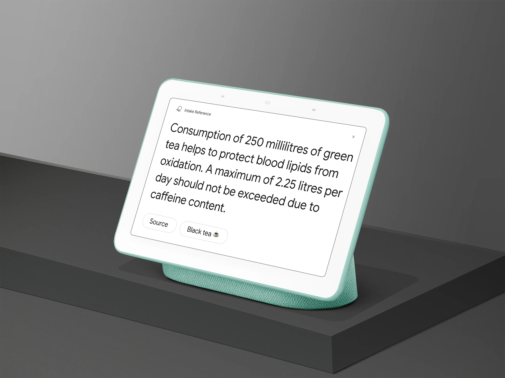
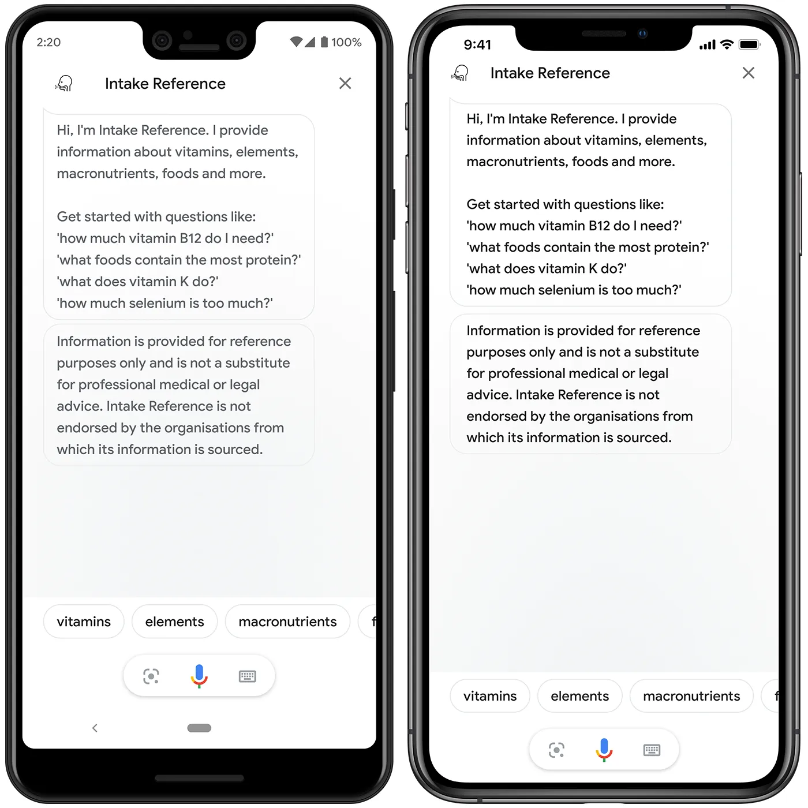
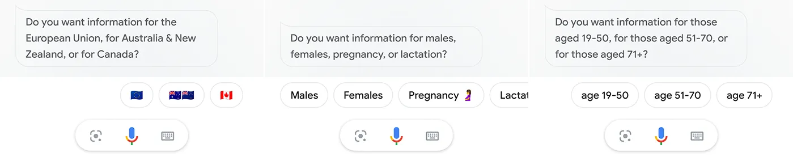
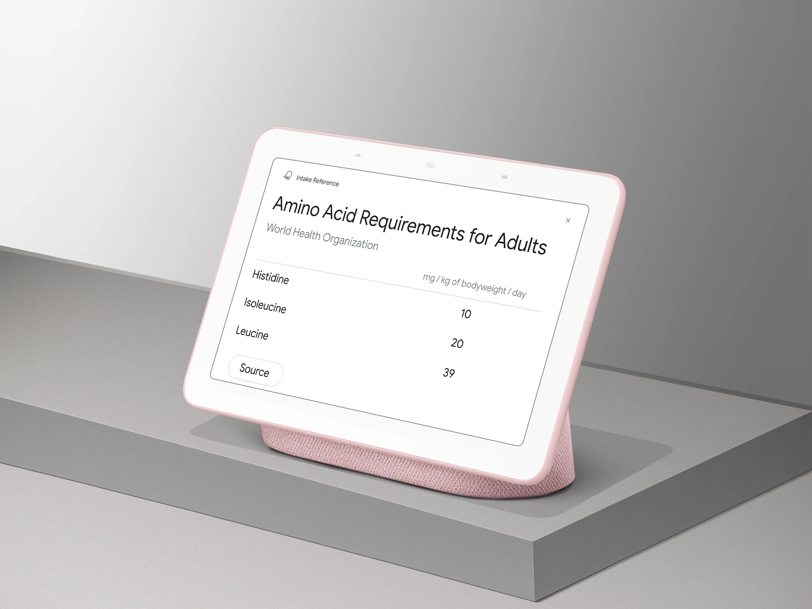

# Intake Reference

**Separating Nutrition Facts from Nutrition Fiction: Bringing together official nutrition and public health recommendations as a voice app and chatbot.**



*Intake Reference* is an app for the Google Assistant & Google Home, and Telegram, which provides information about vitamins, elements, macronutrients, foods, other dietary substances, and certain medications. *Intake Reference* is an easy way to access **only** nutrition and health recommendations which are **recognised by law or published by public health authorities**\*.


The app was developed in an effort to counter widespread nutrition and health misinformation on the internet; all responses are fully cited and links to source information are always provided. ***Intake Reference*** is so-named because the app is a **reference** for appropriate and safe **intake** levels for nutrients and other dietary substances.

Whereas official nutrition and health recommendations are scattered across the internet, buried in PDF documents and lengthy reports — often taking the form of complex tables of data — *Intake Reference* brings information from multiple sources together in one place; the app transforms this information into short yet meaningful and comprehensive answers to common questions, formatted in a user-friendly way.


*Intake Reference is available on any device running the Google Assistant, including Android and iOS devices.*

---

## Types of Queries

### Nutrient Recommendation Queries — *How much of a given nutrient do I need per day? How much is too much?*

*Intake Reference* answers questions about the daily minimum and maximum intake recommendations for nutrients, based on European Food Safety Authority (EFSA) Dietary Reference Values — for the European Union — and the National Health and Medical Research Council (NHMRC) Nutrient Reference Values — for Australia and New Zealand. Where applicable, users can filter recommendations by age, biological sex, life stage (such as pregnancy, lactation, and pre/post menopause), activity level, and jurisdiction.


*To get personalised answers, users can filter recommendations by jurisdiction, biological sex, life stage, age, activity level, and other factors (where applicable).*

### Health Claim Queries — *What are the health benefits of a given nutrient? Why do we need a given nutrient?*

*Intake Reference* answers questions about the health effects of nutrients and other substances, based on authorised nutrition claims set by the European Commission, Food Standards Australia New Zealand (FSANZ), Health Canada, and the United States Food & Drug Administration (FDA), as well as drug monographs.

### Food Source Queries — *Which foods contain the most of a given nutrient?*

*Intake Reference* provides information about the highest food sources of nutrients and other substances, based on food composition data from the United States Department of Agriculture (USDA) and other sources.

### Example Queries

In addition to the types of queries listed above, *Intake Reference* can also answer queries such as:

- *How much calcium does my child need?*
- *Tell me about olive oil polyphenols.*
- *How many calories per gram of fat?*
- *What nutrients do I need during pregnancy?*
- *Does zinc oxide prevent sunburn?*
- *Do food colourings affect attention in children?*
- *Is it safe to combine caffeine and alcohol?*
- *Is liquorice safe for people with hypertension?*
- *Is it safe to consume caffeine during pregnancy?*
- *Can plant sterols reduce cholesterol?*
- *How many calories does a soldier need every day?*
- *What are the benefits of calcium post-menopause?*
- *Does melatonin help with jet-lag?*

… and more.

---

## Types of Substances

Users can ask *Intake Reference* various questions about the following substances:

| Category | Covered Substances |
| :--- | :--- |
| **Vitamins** | vitamin A (β-carotene & retinol) • vitamin B1 (thiamine) • vitamin B2 (riboflavin) • vitamin B3 (niacin) • vitamin B5 (pantothenic acid) • vitamin B6 (pyridoxine) • vitamin B7 (biotin) • vitamin B9 (folic acid) • vitamin B12 (cobalamin) • choline • vitamin C (ascorbic acid) • vitamin D (ergocalciferol & cholecalciferol) • vitamin E (α-tocopherol) • vitamin K (phylloquinone) |
| **Elements** | bismuth • boron • calcium • chloride • chromium • cobalt • copper • fluoride • iodine • iron • magnesium • manganese • molybdenum • phosphorus • potassium • selenium • sodium • sulphur • titanium • zinc |
| **Macronutrients** | alcohol • α-linolenic acid • carbohydrates • energy • fat • fiber • linoleic acid • protein • water |
| **Amino acids** | histidine • isoleucine • leucine • lysine • methionine & cysteine • phenylalanine & tyrosine • threonine • tryptophan • valine |
| **Flavonoids** | apigenin • catechin • cyanidin • delphinidin • epicatechin • epigallocatechin • eriodictyol • hesperetin • isorhamnetin • kaempferol • luteolin • malvidin • myricetin • naringenin • pelargonidin • peonidin • petunidin • thearubigin • quercetin |
| **Other substances** | activated charcoal • algal oil • α-carotene • arabinoxylan • betaine • β-cryptoxanthin • β-glucan • black tea (*Camellia sinensis*) • caffeine • cannabidiol • carbohydrate-electrolyte solutions • cholesterol • creatine • flaxseed (*Linum usitatissimum*) • food colourings • fructose • glucomannan • green tea (*Camellia sinensis*) • hydroxytyrosol • kava (*Piper methysticum*) • liquorice (*Glycyrrhiza glabra*) • lutein • lycopene • melatonin • monacolin K • pectin • phytosterols • polyphenols (from olive oil) • probiotics • prunes (*Prunus domestica*) • psyllium seed fibre • resistant starch • soybeans (*Glycine max*) • tocopherols • tocotrienols • tomatoes (*Solanum lycopersicum*) • walnuts (*Juglans regia*) • zeaxanthin • zinc oxide • zinc pyrithione |

---

## Information Sources



*Intake Reference* sources its information from the following organisations:

- Canadian Centre on Substance Use and Addiction
- Canadian Food Inspection Agency
- European Food Safety Authority (EFSA)
- Food Standards Australia New Zealand (FSANZ)
- Health Canada
- National Health and Medical Research Council (NHMRC)
- Public Health England
- United States Department of Agriculture (USDA)
- United States Department of Health and Human Services (HHS)
- United States Food and Drug Administration (FDA)
- World Health Organization (WHO)

… in addition to open-license articles published in reputable scientific journals.

> **\*** *Intake Reference* is not endorsed by any of the aforementioned organisations from which its information is sourced.

---

## Platforms & Usage

### Google Home & Google Assistant

*Intake Reference* was built for devices running the Google Assistant, including smart displays, smart speakers, smart TVs, watches, tablets, and phones:

```text
"Hey Google, talk to Intake Reference."
"Hey Google, ask Intake Reference how much vitamin C do I need every day?"

```

### Telegram

Talk to *Intake Reference* on **Telegram** by messaging [@IntakeReferenceBot](https://telegram.me/intakereferencebot).

### Phone Call

Talk to *Intake Reference* by calling **+1 (802) 449-6968** (charges may apply).

### Usage Statistics (2018–2019)

* **Daily Unique Active Users (Aug–Oct 2018):** > 1,200
* **Google Assistant Implicit Invocation Redirects (2018–2019):** ~10,000 (selected as the user's answer > 4,500 times)
* **Monthly Unique Sessions (June–July 2019):** > 5,600


